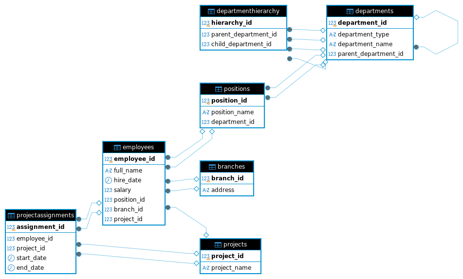

# 13.01 Базы данных

----------------------------------------------------------------------------------------------------------------
### Легенда

Заказчик передал вам [файл в формате Excel](Files/hw-12-1.xlsx) , в котором сформирован отчёт.

На основе этого отчёта нужно выполнить следующие задания.


## Задание 1

1. Опишите не менее семи таблиц, из которых состоит база данных. Определите:
- какие данные хранятся в этих таблицах,
- какой тип данных у столбцов в этих таблицах, если данные хранятся в **PostgreSQL**.
2. Начертите схему полученной модели данных. Можете использовать онлайн-редактор: https://app.diagrams.net/

### Этапы реализации:
1. Внимательно изучите предоставленный вам файл с данными и подумайте, как можно сгруппировать данные по смыслу.
2. Разбейте исходный файл на несколько таблиц и определите список столбцов в каждой из них.
3. Для каждого столбца подберите подходящий тип данных из **PostgreSQL**.
4. Для каждой таблицы определите первичный ключ **(PRIMARY KEY)**.
5. Определите типы связей между таблицами.
6. Начертите схему модели данных. На схеме должны быть чётко отображены:
- все таблицы с их названиями,
- все столбцы с указанием типов данных,
- первичные ключи (они должны быть явно выделены),
- линии, показывающие связи между таблицами.

*Результатом выполнения задания должен стать скриншот получившейся схемы базы данных.*

## Ответ:

**1 - Анализ данных и проектирование таблицы**

После изучения представленной таблицы  были сделаны следующие выводы:

**Таблица 1 -  Сотрудники (Employees)**
- employee_id SERIAL PRIMARY KEY
- full_name VARCHAR(100)
- hire_date DATE
- salary NUMERIC(10,2)
- position_id INT REFERENCES Positions(position_id)
- branch_id INT REFERENCES Branches(branch_id)
- project_id INT REFERENCES Projects(project_id)

**Таблица 2 -  Должности (Positions):**
- position_id SERIAL PRIMARY KEY
- position_name VARCHAR(100)
- department_id INT REFERENCES Departments(department_id)

**Таблица 3 - Подразделения (Departments):**
- department_id SERIAL PRIMARY KEY
- department_type VARCHAR(50)
- department_name VARCHAR(200)
- parent_department_id INT REFERENCES Departments(department_id)

**Таблица 4 - Филиалы (Branches):**
- branch_id SERIAL PRIMARY KEY
- address TEXT

**Таблица 5 - Проекты (Projects):**
- project_id SERIAL PRIMARY KEY
- project_name VARCHAR(200)

**Таблица 6 - Назначения на проекты (ProjectAssignments):**
- assignment_id SERIAL PRIMARY KEY
- employee_id INT REFERENCES Employees(employee_id)
- project_id INT REFERENCES Projects(project_id)
- start_date DATE
- end_date DATE

**Таблица 7 - Иерархия подразделений (DepartmentHierarchy):**
- hierarchy_id SERIAL PRIMARY KEY
- parent_department_id INT REFERENCES Departments(department_id)
- child_department_id INT REFERENCES Departments(department_id)

**2 - Схема связей:**
- Employees связаны с Positions (один ко многим)
- Positions связаны с Departments (один ко многим)
- Employees назначаются на Projects (многие ко многим через ProjectAssignments)
- Departments имеют иерархические связи (самоссылка)
- Employees привязаны к Branches (многие к одному)

**3 - Типы связей:**
- Employees → Positions: один ко многим
- Positions → Departments: один ко многим
- Employees → Branches: многие к одному
- Employees → Projects: многие ко многим (через ProjectAssignments)
- Departments → Departments: самоссылка (иерархия)

**4 - Схема базы данных созданная с помощью** **https://app.diagrams.net/:**


----------------------------------------------------------------------------------------------------------------

## Задание 2*

1. Разверните СУБД Postgres на своей хостовой машине, на виртуальной машине или в контейнере docker.
2. Опишите схему, полученную в предыдущем задании, с помощью скрипта SQL.
3. Cоздайте в вашей полученной СУБД новую базу данных и выполните полученный ранее скрипт для создания вашей модели данных.

**В качестве решения приложите SQL скрипт и скриншот диаграммы.**

Для написания и редактирования **sql** удобно использовать специальный инструмент **dbeaver.**

## Ответ:

**В ходе выполнения этого задания было проделано:**

1. Для написания,создания схемы базы данных был установлен и использован **DBeaver** — это универсальный графический клиент для работы с базами данных.
2. Развернута СУБД в Docker-контейнере с предустановленной базой данных **PostgreSQL** и создана новая база данных - **mynew_bd** согласно спроектированной **ER-диаграмме.** которая, включает 7 таблиц и 10  корректных  (FK) связей,реализованой иерархией данных через систему внешних ключей, а так же обеспечена целостность данных через ограничения и связи.

**Этапы выполнения задания:**

1. Установка DBeaver.

```
- sudo wget -O /usr/share/keyrings/dbeaver.gpg.key https://dbeaver.io/debs/dbeaver.gpg.key
- echo "deb [signed-by=/usr/share/keyrings/dbeaver.gpg.key] https://dbeaver.io/debs/dbeaver-ce /" | sudo tee /- etc/apt/sources.list.d/dbeaver.list
- sudo apt update
- sudo apt install dbeaver-ce
```


2. Разворачиваем СУБД Postgres в Docker-контейнере и с помощью него создаем новую базу данных.

[Конфигурационный файл: docker-compose-postgre-sql.yml](Files/docker-compose-postgre-sql.yml)


3. Запускаем dbeaver.


Далее все выполняем в dbeaver.

4. Подключаемся к СУБД, которая у нас развёрнута в системе, и к которой мы хотим подключиться, в нашем случае это PostgreSQL.


5. Загружаем наш SQL Script 1 для создания таблиц.

[Script -1.sql](Files/Scripts/create_database.sql)


6. Загружаем  и запускаем Script 2 для:

[Script-2.sql](Files/Scripts/list_foreign_keys_with_targets.sql)

 Этот скрипт полный список внешних ключей с указанием.
*Его назначение:* получить читаемую карту всех внешних ключей в схеме: «откуда → куда».
*Как результат:* таблица вида: - constraint_name | table_name | column_name | foreign_table_name | foreign_column_name.
*Когда использовать:*
- при проектировании/рефакторинге схемы,
- для документации,
- чтобы быстро понять, какие таблицы связаны и по каким полям,
- перед удалением таблиц/столбцов (чтобы не сломать FK).
*Что получаем:* мы сразу видим все связи и можем, например, составить список зависимостей или проверить, что все ожидаемые связи на месте.


7. Загружаем и запускаем Script 3 для:

[Script-2.sql](Files/Scripts/scheck_fk_duplicates.sql)

Этот запрос ищет дублирующиеся определения внешних ключей в схеме public.
*Его назначение:* выявление потенциально дублирующихся определений внешних ключей.
*Когда использовать:*
- после массовых изменений структуры БД,
- при миграции,
- при подозрении на повторяющееся создание FK.
*Что считать нормой:*  - пустой результат (нет дублей).
*Если есть строки:* нужно смотреть, почему одно и то же имя ограничения попало в метаданные несколько раз; часто проблема в том, что миграции запускались многократно без проверок.


**Итог всей проделанной работы:**

Диаграмма нашей базы данных.




----------------------------------------------------------------------------------------------------------------